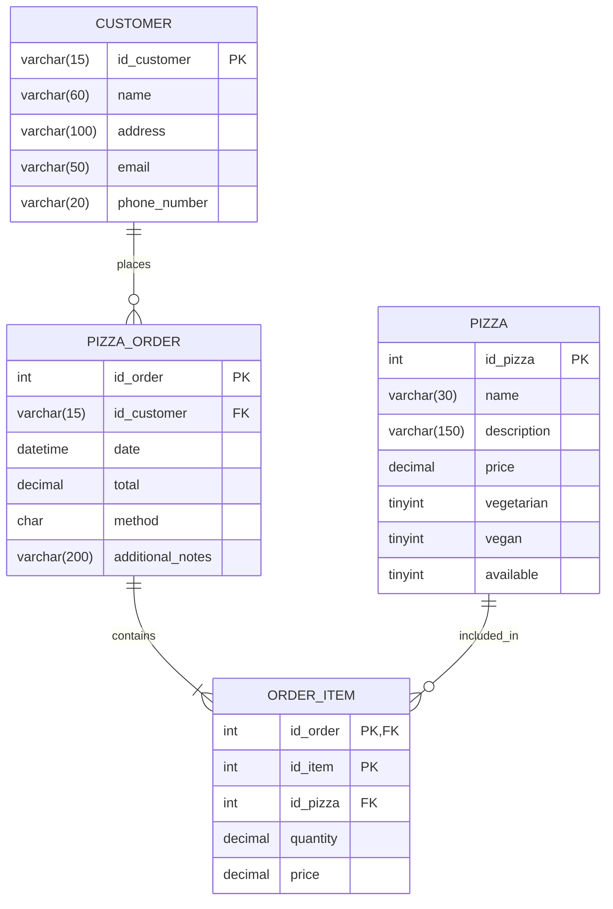

# 🍕 Platzi Pizzeria API


API RESTful empresarial desarrollada con **Spring Boot**, **Spring Data JPA** y **MySQL** para la gestión integral de una pizzería: catálogo de pizzas, clientes, pedidos e ítems con modelado de datos avanzado y consultas optimizadas.

---

## 🚀 Características Principales

* **Modelado Relacional Avanzado:** Mapeo de relaciones `@OneToOne`, `@OneToMany` y manejo de **Claves Primarias Compuestas** mediante `@IdClass` y serialización (`Serializable`).
* **Paginación y Ordenamiento Dinámico:** Endpoints optimizados con `PagingAndSortingRepository` y parámetros `Pageable` y `Sort`.
* **Spring Data Query Methods:** Métodos de consulta derivados para búsquedas avanzadas (búsqueda por ingredientes con ignore case, filtros booleanos, top de precios, conteos condicionales).
* **Consultas Nativas y Modificadoras:** Uso de `@Query` nativo en MySQL, manipulación masiva con `@Modifying` y expresiones SpEL (`:#{#dto.property}`).
* **Proyecciones (Interface-based Projections):** Extracción de resúmenes consolidados (`OrderSummary`) mediante funciones de agregación SQL (`GROUP_CONCAT`, `JOIN`) sin sobrecarga de entidades completas.
* **Patrón DTO y Transaccionalidad:** Separación de capas con DTOs (`UpdatePizzaPriceDto`) y control transaccional estricto con `@Transactional`.
* **Seguridad de Configuración:** Credenciales de base de datos externalizadas mediante variables de entorno del sistema (`${DB_USERNAME}`, `${DB_PASSWORD}`).

---

## 🗄️ Modelo Entidad-Relación



---

## 🛠️ Tecnologías y Herramientas

* **Lenguaje:** Java 21 LTS
* **Framework:** Spring Boot (Web, Data JPA)
* **ORM:** Hibernate
* **Base de Datos:** MySQL Server 8.x
* **Librerías de Utilidad:** Project Lombok
* **Gestor de Dependencias:** Gradle
* **Pruebas de API:** Postman

---

## 📋 Endpoints de la API

### 🍕 Pizzas (`/api/pizzas`)

| Método | Endpoint | Descripción | Parámetros / Body |
| :--- | :--- | :--- | :--- |
| `GET` | `/api/pizzas` | Listado paginado de todas las pizzas | `?page=0&elements=8` |
| `GET` | `/api/pizzas/{idPizza}` | Obtener una pizza por su ID | `idPizza` en la ruta |
| `GET` | `/api/pizzas/available` | Pizzas disponibles con paginación y ordenamiento | `?page=0&elements=8&sortBy=price&sortDirection=ASC` |
| `GET` | `/api/pizzas/name/{name}` | Buscar pizza por nombre (ignora mayúsculas/minúsculas) | `name` en la ruta |
| `GET` | `/api/pizzas/with/{ingredient}` | Pizzas que contengan un ingrediente específico | `ingredient` en la ruta |
| `GET` | `/api/pizzas/without/{ingredient}` | Pizzas que **no** contengan un ingrediente | `ingredient` en la ruta |
| `GET` | `/api/pizzas/cheapest/{price}` | Top 3 de pizzas más económicas menores o iguales al precio | `price` en la ruta |
| `POST` | `/api/pizzas` | Crear una nueva pizza | JSON con datos de la pizza |
| `PUT` | `/api/pizzas` | Actualizar una pizza existente | JSON con datos completos |
| `PUT` | `/api/pizzas/price` | Actualizar precio de una pizza usando DTO | Body: `{"pizzaId": 1, "newPrice": 18.5}` |
| `DELETE`| `/api/pizzas/{idPizza}` | Eliminar una pizza por su ID | `idPizza` en la ruta |

### 📦 Órdenes (`/api/orders`)

| Método | Endpoint | Descripción |
| :--- | :--- | :--- |
| `GET` | `/api/orders` | Obtiene el histórico completo de pedidos |
| `GET` | `/api/orders/today` | Obtiene las órdenes registradas durante el día de hoy |

### 👤 Clientes (`/api/customers`)

| Método | Endpoint | Descripción |
| :--- | :--- | :--- |
| `GET` | `/api/customers/phone/{phone}` | Buscar datos del cliente por número telefónico |

---

## ⚙️ Instalación y Puesta en Marcha

### Prerrequisitos
* Java Development Kit (JDK) 21 instalado.
* Servidor MySQL en ejecución con una base de datos llamada `pizzeria`.

### 1. Clonar el repositorio
```bash
git clone https://github.com/TU_USUARIO/platzi-pizzeria.git
cd platzi-pizzeria
```

### 2. Configurar Variables de Entorno
El proyecto utiliza variables de entorno para evitar exponer credenciales sensibles en el archivo `application.properties`:

* `DB_USERNAME`: Tu usuario de MySQL (ej. `root`).
* `DB_PASSWORD`: Tu contraseña de MySQL.

Puedes configurarlas en tu IDE (como IntelliJ IDEA en *Run/Debug Configurations*) o desde la terminal:

**Windows (PowerShell):**
```powershell
$env:DB_USERNAME="root"
$env:DB_PASSWORD="tu_password"
```

**Linux / macOS:**
```bash
export DB_USERNAME=root
export DB_PASSWORD=tu_password
```

### 3. Compilar y Ejecutar
Usa el wrapper de Gradle incluido:

**Windows:**
```bash
.\gradlew.bat bootRun
```

**Linux / macOS:**
```bash
./gradlew bootRun
```

La aplicación arrancará en el puerto configurado: **`http://localhost:8081`**.

---

## 👨‍💻 Autor

Proyecto desarrollado como parte de la especialización de **Spring Data JPA** en Platzi.
